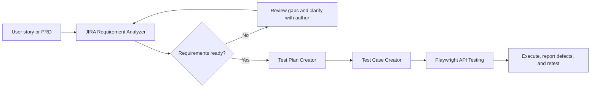
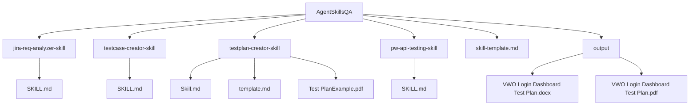

# AgentSkillsQA

A collection of AI-agent skills for practical QA and software-testing workflows, from requirement review through test planning and API test automation.

## Skills

| Skill | Purpose |
|---|---|
| [JIRA Requirement Analyzer](./jira-req-analyzer-skill/SKILL.md) | Assesses whether a JIRA story is ready to test, identifies gaps and risks, and prepares clarifying questions for human review. |
| [Test Case Creator](./testcase-creator-skill/SKILL.md) | Provides a starting point for creating and reviewing test cases. |
| [Test Plan Creator](./testplan-creator-skill/Skill.md) | Creates a professional test plan from user-provided requirements, following the included template. |
| [Playwright API Testing](./pw-api-testing-skill/SKILL.md) | Provides a starting point for API testing with Playwright. |
| [Skill Template](./skill-template.md) | Reusable front matter and instructions for creating additional QA skills. |

The test-plan skill includes its [test plan template](./testplan-creator-skill/template.md) and a [sample plan](./testplan-creator-skill/Test%20PlanExample.pdf).

## QA workflow

The skills can be used independently or as stages in a requirements-to-testing workflow. Review the relevant skill instructions before applying them; each skill defines its own scope and output.

## Repository map

## Example output

The [`output/`](./output/) directory contains a VWO Login Dashboard test plan in Word and PDF formats. It was prepared from the supplied PRD and template. Optional or proposed features are identified for scope confirmation rather than treated as confirmed product behavior.

## Using a skill

1. Open the relevant skill's `SKILL.md` (or `Skill.md`) and review its usage guidance.
2. Provide the requirement, ticket, or testing task the skill requests.
3. Confirm assumptions, scope, and any questions raised before treating generated test material as approved.

These skills are guidance for an AI-assisted workflow; they do not replace product-owner decisions, security approvals, or QA sign-off.
